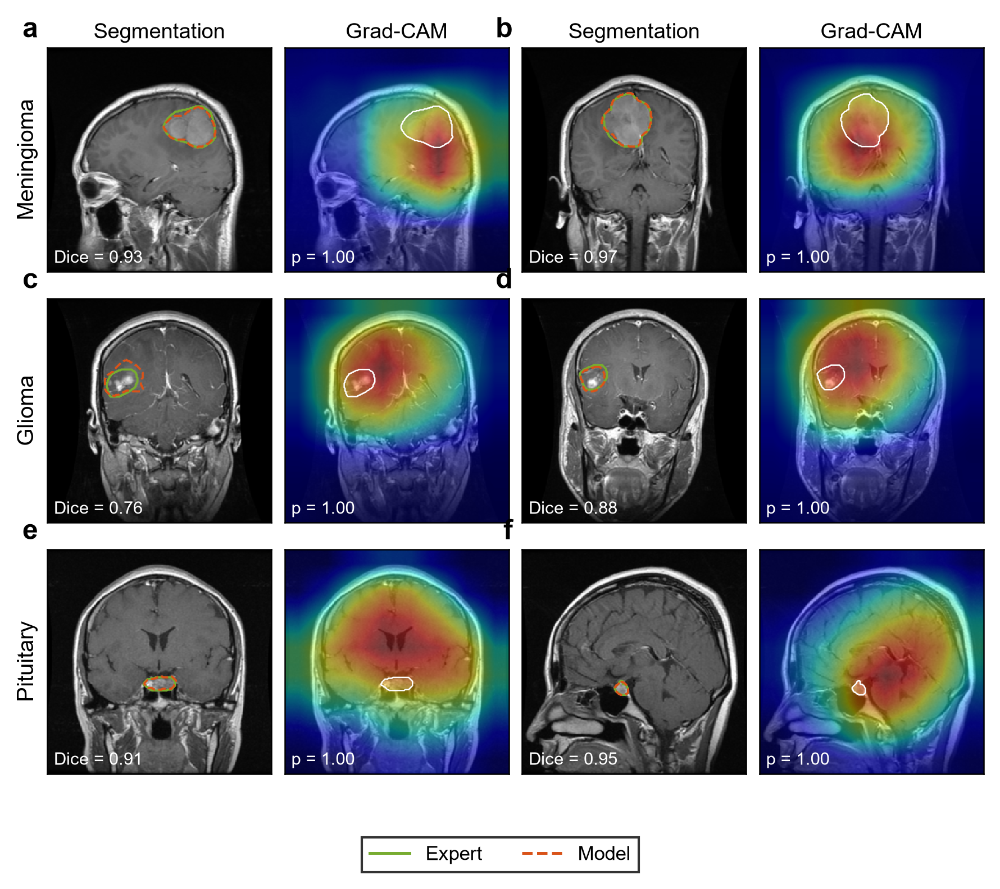
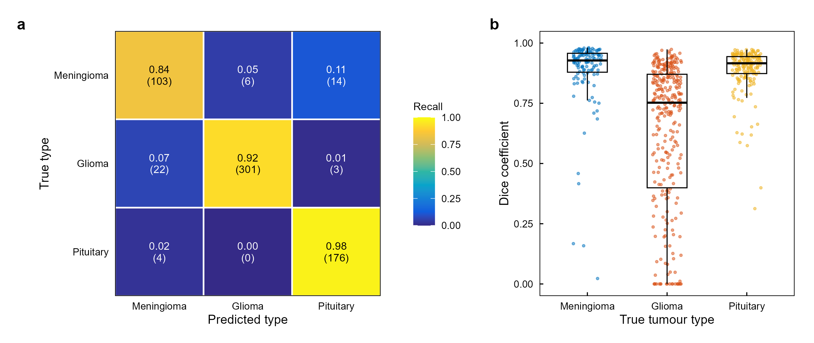
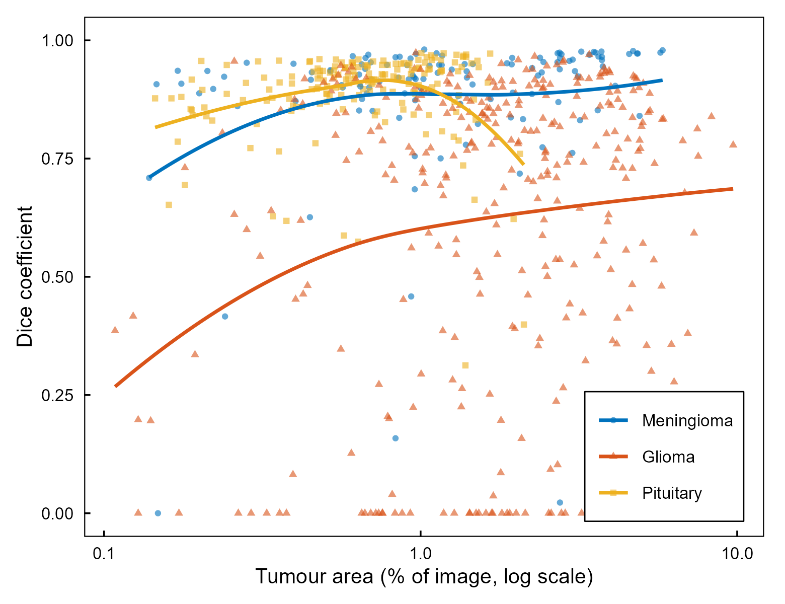
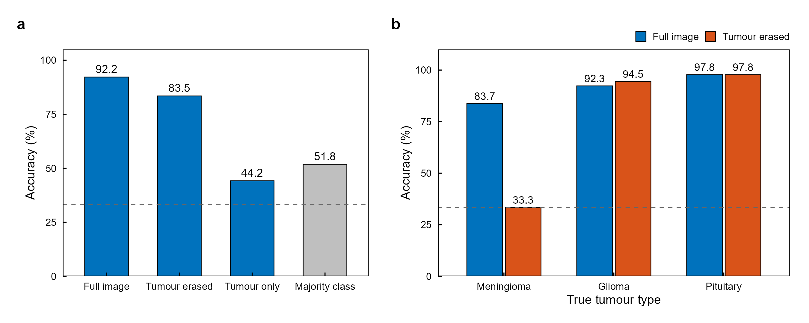
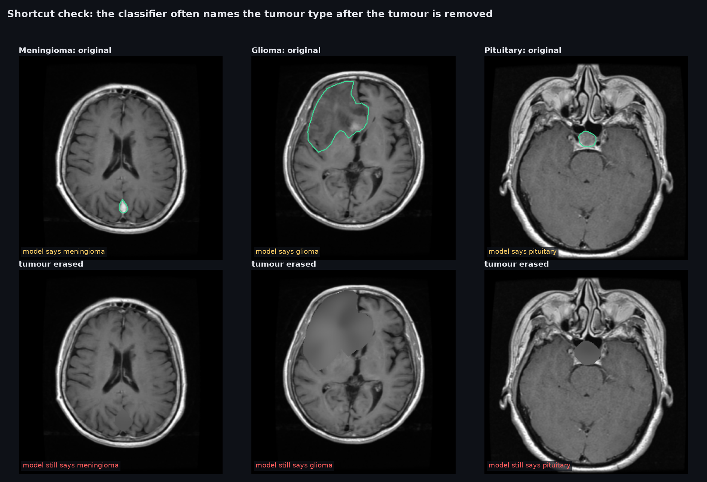
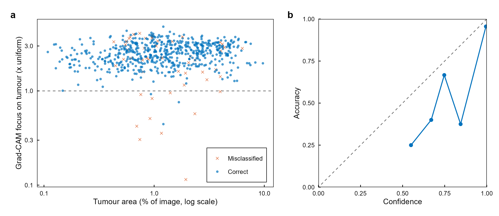

# Oncoscope

**Finds and outlines brain tumours on MRI and names the tumour type, then checks whether that diagnosis actually comes from the tumour.**



<sub>**Figure 1.** Two representative correctly classified test slices per tumour type (**a–f**). Left of each pair: expert outline (green) and model outline (orange, dashed), with the Dice coefficient. Right: Grad-CAM attention for the predicted class, with the expert outline in white and the predicted probability.</sub>

A single network takes a contrast-enhanced T1 MRI slice and does two things at once:

1. **Segmentation:** draws the tumour boundary pixel by pixel.
2. **Classification:** says whether the tumour is a **meningioma**, **glioma** or **pituitary tumour**.

Brain-tumour MRI classifiers often report 95%+ accuracy. This project asks a harder question: *would the model still give the same answer if the tumour weren't there?*

## Results on held-out patients

The test set is **48 patients (629 slices)**. No slice from these patients was used for training, model selection or tuning, and splits are made by patient, stratified by tumour type.

| | |
|---|---|
| Tumour-type accuracy (per slice) | **92.2%** (macro-F1 0.904, κ 0.874) |
| Tumour-type accuracy (per patient) | **93.8%** |
| Tumour outline: Dice, mean / median | **0.746 / 0.870** |
| Calibration error (ECE) | 0.058 |



<sub>**Figure 2.** **a**, Tumour-type confusion matrix on 629 test slices (row-normalised recall, with counts). **b**, Per-slice Dice coefficient by tumour type. Boxes show the median and interquartile range.</sub>

Meningioma and pituitary outlines are close to expert quality (mean Dice 0.88 and 0.89). **Glioma is the hard case** (mean Dice 0.62): gliomas infiltrate surrounding tissue with irregular, ill-defined borders, and 13% of glioma slices are missed entirely.

<p align="center"></p>

<sub>**Figure 3.** Dice coefficient against tumour area (log scale) for every test slice, with LOESS fits per tumour type.</sub>

## Shortcut test: is it reading the tumour?

Every test slice was re-scored twice:

- **Tumour erased:** the expert-outlined tumour, plus a 6-pixel margin, is filled in from the surrounding tissue.
- **Tumour only:** everything outside a box around the tumour is blanked.



<sub>**Figure 4.** **a**, Tumour-type accuracy on the same test slices under each condition. The dashed line is chance (33%). **b**, Accuracy by true tumour type with the full image and with the tumour erased.</sub>

| condition | accuracy |
|---|---|
| full image | 92.2% |
| **tumour erased** | **83.5%** |
| tumour only | 44.2% |
| always guess the most common type | 51.8% |

**With the tumour removed, the classifier still names the tumour type 83.5% of the time.** Most of what looks like diagnosis comes from the rest of the scan. Broken down by type:

| true type | still correct with tumour erased |
|---|---|
| pituitary | 97.8% |
| glioma | 94.5% |
| meningioma | 33.3% |

<p align="center"></p>

<sub>**Figure 5.** Examples (**a–c**) where the prediction is unchanged after the tumour is erased. Top: original slice with the expert outline. Bottom: the same slice with the tumour (plus a 6-pixel margin) inpainted from the surrounding tissue.</sub>

How to read this:

- **Pituitary tumours** always sit in the same place at the skull base, so a slice through that region gives the answer away without looking at the tumour. Slice position and imaging plane are confounded with tumour type in this dataset.
- **Glioma** context is partly *legitimate*. Swelling (oedema) and mass effect extend beyond the expert outline and survive the erasure, so some of that 94.5% is real disease signal, not a shortcut. The test can't fully separate the two.
- **Meningioma** is the only class where removing the tumour collapses the prediction, which is what a model that truly reads the lesion should do.
- *Tumour only* is out of distribution (a mostly black image), so its low score says more about distribution shift than about the tumour.

Grad-CAM points the same way. Attention is 2.5× denser on the tumour than on the rest of the image (median), but it is diffuse: the attention peak lands on the tumour in only 39% of slices, and **misclassified slices cluster where attention misses the tumour**.



<sub>**Figure 6.** **a**, Grad-CAM attention density inside the tumour relative to a uniform map (1×, dashed line), against tumour area, for correctly classified and misclassified slices. **b**, Reliability diagram (bins with fewer than 5 slices omitted). The dashed line is perfect calibration.</sub>

**Takeaway:** a high accuracy number on this benchmark is not evidence that a model has learned tumour appearance. Any claim of diagnostic ability should come with a test like this one. Fixes worth trying: train the classifier on tumour-centred crops, mask context during training, or balance slice positions across classes.

## How it works

```
T1-CE slice (resized to 256x256, percentile-normalised)
        |
   ResNet-18 encoder (ImageNet-pretrained) --> 8x8x512 bottleneck --> global pool --> tumour type (3 classes)
        |  skip connections
   U-Net decoder --> 256x256 tumour mask
```

- **Loss:** BCE + Dice for the mask, plus class-weighted cross-entropy for the type, trained jointly.
- **Augmentation:** flips, ±15° rotation, scale and shift, applied identically to image and mask, plus gamma and contrast jitter and noise.
- **Optimiser:** AdamW, with a lower learning rate for the pretrained encoder and cosine decay. The model was selected on validation-patient Dice + macro-F1 (epoch 17 of 18). Training took about 3 hours on a 14-core laptop CPU, with no GPU.
- **Explainability:** Grad-CAM on the last encoder block, scored against the expert masks (attention share inside the tumour, and a pointing game).

14.3M parameters · PyTorch · torchvision · SciPy · scikit-learn · figures in R (ggplot2, patchwork, ggridges) and matplotlib.

## Reproduce

```bash
pip install torch torchvision --index-url https://download.pytorch.org/whl/cpu
pip install -e ".[dev]"

# download the 4 zip parts from figshare (link below), unzip all .mat files into one folder,
# and set data.mat_dir in configs/default.yaml
oncoscope prepare        # 3,064 slices -> data/cache_256.npz
oncoscope train          # runs/unet-resnet18/best.pt
oncoscope evaluate       # metrics, Grad-CAM and shortcut tests -> runs/unet-resnet18/eval/
python scripts/gallery.py
Rscript r/figures.R
```

Score one slice and get an overlay image:

```bash
oncoscope predict path/to/slice.mat --out prediction.png
```

`pytest` covers the patient-disjoint stratified split, normalisation, image-and-mask alignment under augmentation, Dice, model shapes, Grad-CAM, and the erase and crop transforms. CI runs `ruff` and the tests on every push. The 57 MB checkpoint is not stored in git.

## Limitations

- **One dataset, one split.** 48 test patients from a single source. Patient-level cross-validation and an external dataset are the next steps.
- **2D slices.** Real diagnosis uses the full 3D volume and several MRI sequences.
- **Shortcut test caveats.** Erasing tumour plus margin leaves peritumoural signs behind, and blanking context creates out-of-distribution images. Both tests bound the effect rather than measure it exactly.
- **Not a medical device.** This is a research and portfolio project. It has not been clinically validated.

## Data

*Brain tumor dataset*, Jun Cheng, figshare (2017), [doi:10.6084/m9.figshare.1512427](https://doi.org/10.6084/m9.figshare.1512427), licensed CC BY 4.0. It contains 3,064 T1-weighted contrast-enhanced slices from 233 patients, with tumour masks drawn by the dataset authors. Described in J. Cheng et al., *PLoS ONE* 10(10), 2015 and *PLoS ONE* 11(6), 2016. MRI images shown in the figures are derived from this dataset. No data is stored in this repository.

## License

Code: MIT.
